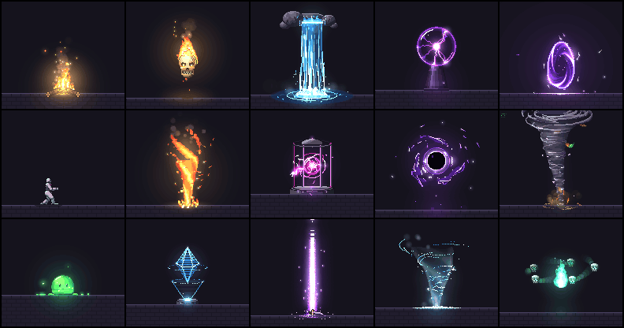
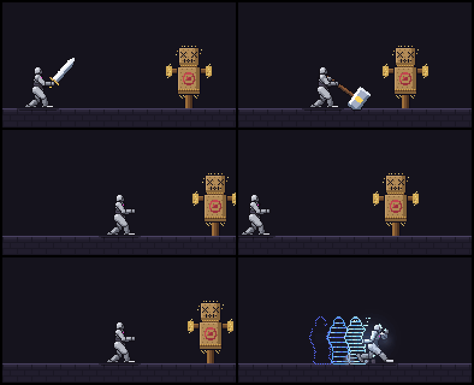

<p align="center">
  
</p>

# pixelfx 中文版（pixelfx-zh）

**<!-- count -->244<!-- /count --> 种像素特效与动画，每一种都是一小段代码。** 火、爆炸、魔法、天气、UI、拾取物、小生物等。实时播放、重新着色、镜像翻转，丢进浏览器游戏直接用，或为任意引擎导出精灵图（Sprite Sheet）。另附一个 Claude Code 技能，让新特效按挑剔像素美术的方式产出：打稿 → 渲染 → 目检 → 打磨。

每个带人物的特效都是**演出来的**：他蓄力、出手、命中顿帧、收招还原，目标挨打后仰。十二套完整连招把特效从起手到收招串成攻击。

**[打开特效画廊](https://patch-gg.github.io/pixelfx/)** · [目录](docs/CATALOG.md) · [演出系统](#演出系统acting) · [技能](#技能the-skill) · [自制特效](#自制特效) · [工作原理](#工作原理)

方法论来自 [Hugo Duprez](https://x.com/HugoDuprez) 的[《如何用 Claude 做出（好看的）像素特效》](https://www.spritefusion.com/blog/how-to-make-good-pixel-art-effects-with-claude)：代码是黏土，相信你的眼睛，喂给 AI 参考。他在 Sprite Fusion 的[开源特效](https://www.spritefusion.com/pixel-art-vfx)立下了标杆，`src/core/sim.js` 与文件头标注的特效改编自他的代码。本仓库是这个思路在库规模上的实践，并附带一个让创作继续下去的技能。

> **这是什么**：本仓库是 [patch-gg/pixelfx](https://github.com/patch-gg/pixelfx)（MIT）的非官方简体中文汉化版。README 已译为中文；代码、注释、`docs/` 工程文档与 Skill 定义保留英文原文（Skill 是 Agent 消费层，保持与上游一致），请对照[上游仓库](https://github.com/patch-gg/pixelfx)阅读。同步基线：上游 2026-10 快照。汉化 by [@bayshier](https://github.com/bayshier)。

## 里面有什么。

<!-- catalog -->
| 分类 | 数量 | 代表 |
|---|---|---|
| **连招 moves** | 12 | 射箭、突斩、震地、掷火球、砸地、圣光轰击… |
| **火 fire** | 12 | 火盆、篝火、蜡烛、喷火、火环、火龙卷… |
| **爆炸 explosions** | 12 | 爆桶、大爆炸、卡通.Pow、尘爆、烟花绽放、烟花火箭… |
| **水 water** | 12 | 气泡、滴水、喷泉、间歇泉、雨花、涟漪… |
| **冰 ice** | 10 | 暴风雪漩涡、冰冻、霜息、霜之新星、冰晶、冰枪… |
| **闪电 lightning** | 11 | 球状闪电、链电、蓄电、带电体、落雷、等离子球… |
| **科幻 sci-fi** | 12 | EMP 冲击、能量核心、力场、故障、全息、喷气背包… |
| **近战 melee** | 12 | 爪击、匕首连斩、双重斩、锤击、重劈、镰刀收割… |
| **打击 impacts** | 11 | 钝击、弹着点、暴击、砸地、重落地、受击白闪… |
| **弹道 projectiles** | 13 | 箭矢、弹道轨迹、炮击、能量盘、信号弹、追踪导弹… |
| **生成与消亡** | 10 | 金币掉落、粉碎、灼烧消散、破壳、烟雾消散、复活光束… |
| **奥术 arcane** | 12 | 奥术光束、奥术飞弹、奥术宝珠、闪入、闪出、魔法阵施法… |
| **神圣 holy** | 10 | 祝福、神盾、羽爆、光环、治疗、治疗之环… |
| **暗影 shadow** | 12 | 黑洞、诅咒、黑暗爆炸、日蚀、攫取之手、hex 印记… |
| **状态 status** | 13 | 流血、燃烧、魅惑、混乱、诅咒、冰冻… |
| **自然 nature** | 13 | 酸液飞溅、巨石、地刺、治愈绽放、落叶风暴、毒云… |
| **天气 weather** | 12 | 极光、暴风雪、樱花、云、落叶、萤火虫… |
| **界面 ui** | 12 | 成就、金币收集、连击计数、彩带、倒计时、暴击数字… |
| **拾取 pickups** | 11 | 开箱、金币旋转、收集爆闪、水晶碎片、宝石旋转、红心拾取… |
| **转场 transitions** | 10 | 百叶窗、烧蚀、CRT 关屏、菱形擦除、故障擦除、光圈… |
| **小生物 critters** | 12 | 蝙蝠、鸟、蝴蝶、眼球、鱼群、飞天骷髅… |
<!-- /catalog -->

每个特效都是 `src/fx/<category>/<name>.js` 里的一个文件。[目录](docs/CATALOG.md)列出了全部。

## 用一个。

**在浏览器游戏里**（canvas、Phaser、PixiJS、Kaplay、three.js），直接用代码。零依赖。

```js
import { createFrame, clearFrame, createFx, composite } from "pixelfx";
import * as frostNova from "pixelfx/fx/ice/frost-nova";
```

## 演出系统（acting）。

<p align="center">
  
</p>

特效单独看像张贴纸。让打击有分量的是身体：预告「要来了」的起手、命中顿帧、目标后仰、收招还原。所以 61 个带人物的特效与 12 套连招都声明了身体在何时做什么：

```js
export const act = {
  target: { x: 58 },
  poses: [
    [-0.55, GUARD],            // 他在特效开始之前就位（t = 0 是特效的第一帧）
    [-0.3, WIND_UP],
    [0, CUT, "snap"],          // "snap" 保持上一姿势并在关键帧跳变
    [0.06, FOLLOW_THROUGH, "snap"],
    [0.86, GUARD],
  ],
  hits: [{ t: 0.06, stop: 0.14, shake: 0.18, amp: 2, push: 2.8, straw: 18 }],   // 命中顿帧 0.14 秒
};
```

把 `createFx` 换成 `createAct`，**连同人物与目标一起播放整段演出**：

```js
import { createFrame, clearFrame, createAct, composite } from "pixelfx";
import * as slash from "pixelfx/fx/melee/sword-slash";

const act = createAct(slash, { x: 80, y: 140 });

function tick(dt) {
  act.update(dt);                                  // 顿帧期间自动保持不动
  clearFrame(frame);
  act.draw(frame);                                 // { body: false } 与 { target: false } 可分别去掉
  composite(frame, img.data, backgroundColor);
  const [sx, sy] = act.shake;                      // 把画面甩这么远
  ctx.putImageData(img, sx, sy);
}
```

**有自己的角色？** 特效 id 没变、精灵图依然是纯特效，现有游戏继续可用。（画在身上的特效会画在标准假人上，要出货就重新生成它们。）时序是纯数据：读 `slash.act`，或精灵图 JSON 里的 `meta.pixelfx.act`（`windup`、`recovery`、带 `t` 与 `freeze` 的 `hits`、`poses`）。在特效开始前那么久启动起手动画，每次命中停更 `freeze` 秒。

画在身上的特效（冰霜、中毒、扫描线）以站姿人物为基准书写，并跟随他到任何地方：姿势的每个像素都知道自己对应站姿的哪个像素。`node tools/act.mjs <id> --sheet` 把整段演出（含人物）烘焙成精灵图。

身体也开放给你用：`skeleton(pose)` 给出姿势的每个 3D 关节供你挂载，`posedParts(pose)` 给出分开绘制的各部位。

## 技能（the skill）。

`pixelfx` 技能教会 Claude Code 查找、使用、导出与创作特效。以插件安装：

```
/plugin marketplace add patch-gg/pixelfx
/plugin install pixelfx@pixelfx
```

或把 `skills/pixelfx` 拷进 `~/.claude/skills/`。然后直接提需求：

- 「给我法师大招加个霜之新星。」
- 「做五个金币拾取的闪光版本，给我看最好的两个。」
- 「把火焰和爆炸两个分类导出成 Godot 用的精灵图。」
- 「这个打击感发飘。让它更重一点。」
- 「给这个法术加个起手，让敌人有反应。」

## 自制特效。

```bash
node tools/new.mjs arcane/my-spell       # 一个能跑的起点（加 --loop 变循环）
node tools/render.mjs arcane/my-spell    # records/arcane/my-spell/contact.png：看图
node tools/check.mjs arcane/my-spell     # 检查越界、接缝、未播种随机数、慢帧
```

然后循环：看联系表、修最糟的一处、再渲染。`--gif` 与 `--mp4` 看动态，`--all` 看每一帧。`node tools/act.mjs arcane/my-spell` 以连续 12 fps 步进展示演出——运动 bug 在采样帧里看不出来。[docs/AUTHORING.md](docs/AUTHORING.md) 是契约、绘图 API 与质量标准。`node tools/serve.mjs` 在本地跑起带你特效的画廊。

## 工作原理。

- **两类特效，零图片。** 纯函数特效导出 `draw(p, t, o)`——只由时间 `t` 决定任意一帧，循环无缝。模拟特效导出 `create(o)`，以 120 Hz 步进真实粒子、碎屑与光源——火花弹跳与烟雾翻卷在任何帧率下都一致。
- **双缓冲。** `color` 收像素：不透明、抖动或真半透明。`light` 收加法发光，叠在其上。滚烫的东西看起来烫，靠的是光缓冲。
- **全部随机数有种子。** 每个随机数来自特效的 seed，第 40 帧每次都一样。
- **局部坐标系。** 特效围绕自己的原点绘制；画师负责摆放、镜像与旋转。方向性特效朝右。一个 24×38 的标准人物替状态、光环与打击出镜。
- **真骨架，画到像素。** 灰色假人刻意做成中性，让眼睛聚焦招式本身、任何特效的颜色都能在它上面成立。他是固定骨长的 3D 骨架——骨盆到脊柱到肩膀——以少数几个平涂色块加一条干净的墨线渲染，正如《死亡细胞》做精灵的方式。所以他能扭转、弯曲、真正转身，深度决定遮挡。姿势按 12 fps 步进定格（手绘精灵的方式），粒子则全帧率奔跑。
- **与 Sprite Fusion 的 VFX 同构的帧结构**（`{ w, h, ox, oy, color, light }`），两个库可以画进同一帧。

## 许可证。

代码与特效均为 MIT，商用随意。部分内容改编自 Hugo Duprez 的 MIT 特效与 Hollow Crown 的 MIT 源码；`gallery/fonts` 里的 Patch Pixel 字体为 Patch 自有、不在覆盖范围：见 [NOTICE.md](NOTICE.md)。

作者为 [Patch](https://patch.gg)；中文翻译 by [@bayshier](https://github.com/bayshier)。
